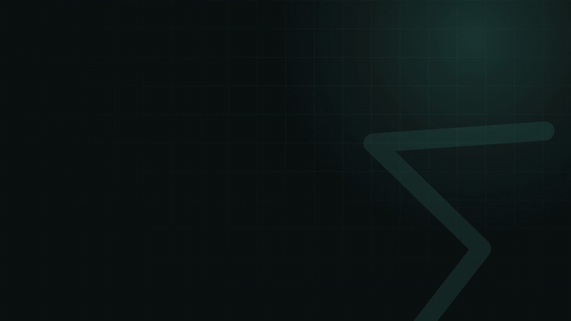

<h1 align="center">∑ web-laas</h1>

<p align="center"><b>把 Emacs 等級的 LaTeX snippet 帶到網頁上的每一個編輯器。</b><br>
打 <code>;a</code> → <code>\alpha</code>、<code>x/</code> → <code>\frac{x}{}</code>、<code>`a</code> → <code>\alpha</code>、<code>ab'.</code> → <code>a\dot{b}</code>。支援 Overleaf、ChatGPT、Claude、Notion、HackMD、Jupyter。</p>

<p align="center"><a href="README.md">English</a></p>

<p align="center">
  <a href="docs/demo.mp4"></a>
  <br><sub>影片裡每一個編輯器狀態，都是真的 engine 算出來的。<a href="docs/demo.mp4">1080p MP4</a> · <a href="demo">影片原始檔（HyperFrames）</a></sub>
</p>

---

如果你在 Emacs 用 [laas](https://github.com/tecosaur/LaTeX-auto-activating-snippets) 和 [cdlatex](https://github.com/cdominik/cdlatex) 寫數學，網頁上的編輯器都會讓你覺得很慢。**web-laas** 把同樣的 snippet 搬到瀏覽器裡：它們是從 Emacs 套件逐條移植的，不是模仿出來的近似版本。Tab 的行為也一樣，是 yasnippet 的欄位跳轉加上 `cdlatex-tab` 的移動規則。

## 功能

- **完整的 laas**：laas.el 的 218 個 snippet 全部都有。
  - `;a`、`;;e`、`;;;e` 這組希臘字母和符號
  - `!=`、`->`、`<=`、`iff`、`inn` 這類運算符號
  - 自動下標：`x1` → `x_1`、`xii` → `x_i`、`x_1` 再打 `2` → `x_{12}`
  - 智慧分數：`x/`、`(a+b)/`、`//`
  - 各種重音符號
- **cdlatex**：
  - `` `a `` 數學符號，按多次 `` ` `` 可以切換層級
  - `'` 修飾：`ab'.` → `a\dot{b}`、`'b` → `\mathbf{}`
  - `_` → `_{}`
  - Tab 指令：`fr⇥`、`sq⇥`、`lr(⇥`、`equ⇥`
  - `$ [ {` 自動配對
- **懂 LaTeX 的 Tab**：
  - 跟 yasnippet 一樣在欄位之間跳，也支援巢狀 snippet。
  - 照 cdlatex 的規則移動：跳出群組、進入下一個空的 `{}`、跳過 `$`。
  - <kbd>Shift</kbd>+<kbd>Tab</kbd> 往回走。
  - 在數學式裡，焦點不會跳到網頁上的其他按鈕。
- **你寫字的地方都能用**：
  - CodeMirror 6（Overleaf、JupyterLab）
  - CodeMirror 5（HackMD）
  - ProseMirror（ChatGPT、Claude）
  - contenteditable（Notion）
  - 一般輸入框
  - 注音、拼音等輸入法也支援。
- **即時預覽**：游標在公式裡時，有一個浮動小視窗即時渲染整條公式，用青綠色直線標出你正在改的位置，還沒填的欄位顯示成 □。
  - 位置可以選：游標上方、游標下方或右下角。
  - 跟著系統的深淺色主題。
  - 按 <kbd>Esc</kbd> 暫時隱藏。
- **直接看排版好的公式**：游標不在裡面的公式，會把渲染結果直接蓋在 LaTeX 原始碼上；游標移進去（或點一下）就變回原始碼。可以在設定頁關掉。
- **每個網站各自的數學環境**：在工具列的 popup 直接選 ` mk`、` dm` 要插入什麼，可選 `$…$` 或 `\(…\)`，以及 `$$…$$`、`\[…\]`、`equation*` 或 `align*`。每個網站會分別記住自己的設定。
- **隨時叫出 cheat sheet**：按 <kbd>⌥</kbd><kbd>⇧</kbd><kbd>K</kbd> 會列出目前網站可以用的所有 snippet，可以搜尋，公式也會直接顯示出來。
- **可以自己設定**：像寫 Emacs 設定檔一樣寫 snippet，在試玩區立刻試用，也可以單獨開關每一組 snippet。

## 安裝

**Chrome、Arc、Edge、Brave**（所有 Chromium 瀏覽器）：

1. 從 [最新 release](https://github.com/william1010121/web-laas/releases/latest) 下載 `web-laas-extension-v*.zip`，然後解壓縮。
2. 開啟 `chrome://extensions`（Arc 是 `arc://extensions`），打開「開發人員模式」，點「載入未封裝項目」，選擇剛才解壓縮的資料夾。
3. 在任何輸入框打 ` mk`，會變成 `$|$`。接著試試 `;a`。

自己 build：

```sh
git clone https://github.com/william1010121/web-laas && cd web-laas
npm install && npm run build      # 輸出到 packages/web-laas/dist
```

想在自己的網頁或 App 裡使用？請參考 npm 上的 [`web-laas-engine`](packages/web-laas-engine)。

## 按鍵

| 按鍵 | 作用 |
|---|---|
| <kbd>⌥</kbd><kbd>⇧</kbd><kbd>K</kbd> | 開啟這個網站的 cheat sheet |
| <kbd>⌥</kbd><kbd>⇧</kbd><kbd>L</kbd> | 開關自動展開，會跳出通知告訴你目前是開還是關 |
| <kbd>Tab</kbd> | 依序嘗試：展開 Tab 型 snippet → 在欄位內移動（cdlatex 規則）→ 跳到下一格 → 離開 snippet |
| <kbd>⇧</kbd><kbd>Tab</kbd> | 往回：群組結尾的內側 → 上一格 → 公式開頭 |
| <kbd>⌫</kbd> | 展開後立刻按，取消剛才的展開 |

## 自訂 snippet

在設定頁的「Snippet 編輯器」裡寫，格式是 JavaScript 物件字面值。程式會解析它，但不會用 `eval` 執行：

```js
{
  snippets: [
    { trigger: "beg", replacement: `\begin{$1}
	$0
\end{$1}`, options: "tA" },
    { group: "機率", options: "mA", snippets: [
      { trigger: "EE", replacement: `\mathbb{E}`, description: "期望值" },
    ] },
  ],
}
```

完整語法請參考[這裡](packages/web-laas-engine#config-language)。

## 致謝

snippet 表格和行為來自兩個 Emacs 套件：TEC 的 [laas](https://github.com/tecosaur/LaTeX-auto-activating-snippets)，以及 Carsten Dominik 的 [cdlatex](https://github.com/cdominik/cdlatex)。Tab 的整合方式則是因 Karthik Chikmagalur 的〈[LaTeX input for impatient scholars](https://karthinks.com/software/latex-input-for-impatient-scholars/)〉而廣為人知。

## 授權

[GPL-3.0-or-later](LICENSE)，跟 laas、cdlatex 相同。
